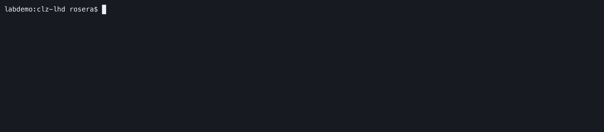

# CLZ Local Host Development (LHD)


[](/LICENSE)


`clz-lhd` is a small local development reverse proxy that maps friendly `.localhost` hostnames to applications running on different local ports. It supports project configuration through `lhd.yaml`, ad-hoc routes from the command line, diagnostics, and Prometheus metrics.

For example, a request to `http://app.localhost` can be proxied to an application listening on `http://localhost:3000`, while `http://api.localhost` can be sent to another service on port 4000.

## See it in action

### Command-line workflow

Start LHD, inspect routes, and use its diagnostics from the command line:



### Live dashboard

Run `clz-lhd dash` in another terminal for a live view of listeners, traffic, route reachability, and recent request results:


## Requirements

- Go 1.25 or later when building from source.
- A platform that resolves `*.localhost` to the local machine. Modern browsers and operating systems normally provide the special-use `.localhost` behaviour without editing a hosts file.
- Permission to bind the selected proxy port. The default is port `80`; use `--port` (or `-p`) to choose another port when needed.

## Build

Clone the repository and build the executable:

```bash
git clone https://github.com/cmdlinezero/clz-lhd.git
cd clz-lhd
go build -o clz-lhd .
```

You can also use `go run .` in the examples below while developing the project.

## Quick start with `lhd.yaml`

The recommended project workflow is to keep an `lhd.yaml` file in the project directory:

```yaml
routes:
  app.localhost: 3000
  api.localhost: 4000
```

A numeric target is shorthand for `http://localhost:<port>`. Start the proxy with:

```bash
./clz-lhd up
```

By default LHD listens on port `80`, so the routes above are available as:

```text
http://app.localhost  -> http://localhost:3000
http://api.localhost  -> http://localhost:4000
```

To use a non-privileged or otherwise different proxy port:

```bash
./clz-lhd up --port 8088
```

Then include that port in the browser or client URL, for example `http://app.localhost:8088`.

Use a different configuration file with `--config` / `-c`:

```bash
./clz-lhd up --config ./config/lhd.yaml --port 8088
```

LHD prints the resolved routes, listening addresses, and metrics endpoint when it starts. `Ctrl-C` (SIGINT) and SIGTERM trigger a graceful shutdown of all listeners.

### Incoming HTTPS

HTTPS is optional and certificate-provider agnostic. Configure a PEM certificate and matching private key:

```yaml
routes:
  app.localhost: 3000
  api.localhost: 4000

tls:
  cert: .lhd/cert.pem
  key: .lhd/key.pem
```

Certificate and key paths are resolved relative to the configuration file. LHD loads and validates the pair before starting. It does not generate certificates or modify the system trust store; the files can come from mkcert, an internal CA, OpenSSL, or other certificate tooling.

#### Generating development certificates

LHD's TLS contract is deliberately simple: provide a PEM certificate and matching PEM private key. Certificate issuance and client trust remain the responsibility of the certificate tooling you choose.

**mkcert** is a straightforward option for local development because it creates a local CA, can install that CA into supported trust stores, and can write the leaf certificate and key directly to paths used by LHD. Install and trust the mkcert CA once according to the [mkcert documentation](https://github.com/FiloSottile/mkcert), then from the directory containing `lhd.yaml` run:

```bash
mkdir -p .lhd
mkcert -cert-file .lhd/cert.pem -key-file .lhd/key.pem "*.localhost" localhost
```

With the `tls` configuration above, no additional LHD-specific certificate setup is required. Keep private keys such as `.lhd/key.pem` out of source control. The repository `.gitignore` ignores the root `.lhd` directory for this reason.

A certificate for `*.localhost` covers one hostname label beneath `.localhost`, such as `app.localhost` and `api.localhost`. It does not cover deeper names such as `api.dev.localhost`; include those names explicitly or use an appropriate certificate for the hostname structure you choose. `clz-lhd doctor` verifies the configured routes against the certificate.

**Bring your own certificate** is equally supported. A development CA, corporate/internal PKI, OpenSSL-based workflow, or other tooling can provide the same PEM certificate/key pair. LHD does not require or detect a particular provider.

**Caddy users:** Caddy has its own Local HTTPS architecture. For local/internal names it can operate a local CA, manage leaf certificates in its storage, and install its root CA into local trust stores when permitted. LHD does not depend on Caddy or reach into Caddy's managed certificate storage. If Caddy is already your HTTPS endpoint, it may be simpler to let Caddy own that responsibility; if your PKI independently provides portable PEM certificate/key files, LHD can consume them like any other certificate source. See Caddy's [Automatic HTTPS documentation](https://caddyserver.com/docs/automatic-https) for its supported model.

##### Trust, validity, and hostname coverage

These are separate concerns:

- **Validity** — the certificate is within its `NotBefore`/`NotAfter` dates.
- **Hostname coverage** — the certificate SANs cover each configured route hostname.
- **Client trust** — the browser, operating system, runtime, or other client trusts the CA that issued the certificate.

`clz-lhd doctor` checks the first two because they can be determined reliably from the supplied certificate. It reports issuer information to help identify the certificate source, but it does not assert client trust or modify trust stores. A certificate can therefore pass LHD diagnostics and still produce a browser warning when that browser does not trust its issuing CA.

When `tls` is configured, LHD serves the same routes over both HTTP and HTTPS. HTTPS defaults to port `8443` and can be changed with `--tls-port`:

```bash
./clz-lhd up --port 8080 --tls-port 8443
```

The routes are then reachable at both `http://app.localhost:8080` and `https://app.localhost:8443`. LHD does not automatically redirect HTTP to HTTPS.

#### Ports and protocol exposure

| Protocol | Default port | Configuration | Purpose |
| --- | ---: | --- | --- |
| HTTP | `80` | `--port` / `-p` | Incoming HTTP proxy traffic and `/metrics` |
| HTTPS | `8443` | `up --tls-port` | Incoming HTTPS proxy traffic when `tls` is configured |
| Status API | `9099` | `--status-port` | Loopback-only live runtime status for `dash` and other local clients |

The HTTP and HTTPS proxy listeners use TCP. The status API is separate and binds explicitly to `127.0.0.1`, so it is not exposed on external interfaces by default. If LHD runs inside a container, VM, remote-development environment, or behind a firewall, expose or forward the listener ports that clients need to reach. LHD does not configure Docker mappings, firewall rules, VM forwarding, or remote-development port exposure itself.

The status API is read-only and versioned at `http://127.0.0.1:9099/v1/status`. Both status endpoints send `Cache-Control: no-store` to discourage caching live operational data. It returns the current listener, route, reachability, request, and 60-second traffic snapshot as JSON. Change its loopback port with `--status-port`; LHD fails startup if that port is unavailable rather than silently disabling live status.

Recent request lifecycle metadata is available from `GET http://127.0.0.1:9099/v1/requests` (on the same loopback-only status port). The JSON response is an object containing an `events` array, **newest first**, capped at 256 events across HTTP and HTTPS proxy listeners. Each event includes `id` (request correlation ID), `phase` (`request_started`, `response_started`, or `request_completed`), `at` (timestamp), `host`, `method`, `path`, `status`, `duration_ms`, and `cancelled`. Status is `0` before a response starts; duration is `0` on request start. `cancelled` indicates request-context cancellation at completion. The array is empty when no requests have been observed. Query strings, headers, and request/response bodies are not stored or returned, but **URL paths may themselves contain sensitive information**. Keep the local status listener private; do not expose it publicly. This endpoint is a bounded snapshot, not a lossless event stream; polling may miss events during heavy traffic.


The incoming LHD listener ports are separate from upstream application ports such as `3000` and `4000`. Exposing only the HTTPS listener externally is fine when clients do not need direct HTTP access, but LHD still starts its HTTP listener and `/metrics` remains available there.

## Configuration

The configuration file contains a `routes` mapping from request hostnames to upstream targets and can optionally contain incoming TLS certificate paths:

```yaml
routes:
  app.localhost: 3000
  api.localhost: http://127.0.0.1:8080
  secure-api.localhost: https://127.0.0.1:8443

tls:
  cert: .lhd/cert.pem
  key: .lhd/key.pem
```

Targets can be either:

- a port number from `1` to `65535`, expanded to `http://localhost:<port>`; or
- an explicit `http://` or `https://` URL with a host.

Hostnames are normalized to lowercase and a trailing dot is removed. Invalid hosts, invalid targets, duplicate routes, unknown YAML fields, malformed YAML, and empty route sets are rejected before the proxy starts.

An `https://` target means LHD connects **to the upstream using HTTPS**; this is independent of incoming TLS. With a `tls` block, LHD also terminates HTTPS for incoming local requests using the configured certificate and key.

### LAN services and Ollama

An explicit URL target may point to another machine on a trusted LAN, not just a local port. For example, if Ollama is running on a separate machine:

```yaml
routes:
  ollama.localhost: http://192.168.1.50:11434
```

Replace the example IP with your Ollama server's LAN address. Start LHD normally, then check the upstream and list available models:

```bash
./clz-lhd doctor --config lhd.yaml
./clz-lhd up --config lhd.yaml
# In another terminal:
curl http://ollama.localhost/api/tags
```

For a model already installed on that machine, test an incremental response (replace `YOUR_MODEL`):

```bash
curl -N http://ollama.localhost/api/generate \
  -H 'Content-Type: application/json' \
  -d '{"model":"YOUR_MODEL","prompt":"Count from one to ten.","stream":true}'
```

Ollama must listen on an address reachable from the LHD machine, and the LAN firewall must permit the connection. Restrict access to trusted clients: Ollama's HTTP API should not be exposed directly to untrusted networks. `doctor` checks TCP reachability, not model availability or API correctness. The proxy forwards streaming HTTP responses incrementally; the `curl -N` option disables curl's output buffering. Incoming HTTPS on LHD does **not** encrypt an `http://` LAN upstream hop—use an HTTPS upstream or a trusted network when confidentiality is required.

LHD preserves the original request `Host` header when proxying. If your Ollama deployment or another upstream rejects `ollama.localhost` as its Host, that requires separate compatibility handling; this example does not change Host rewriting behaviour.

## Commands

Commands accept flags only; unexpected positional arguments are rejected.

### `up`

Start the proxy using a configuration file. The default file is `lhd.yaml`.

```bash
./clz-lhd up
./clz-lhd up --config ./other.yaml
./clz-lhd up --tls-port 8443
./clz-lhd up --port 8088
```

### `dash`

Show a live terminal dashboard for a running LHD instance:

```bash
./clz-lhd dash
./clz-lhd dash --status-port 9199
```

`dash` connects only to the loopback status API and polls it once per second. It shows HTTP/HTTPS listener state, current in-flight requests, the aggregate requests-per-second traffic history for the last 60 seconds, and per-route reachability and recent request results. Listener and route markers make connected, unknown, refused, and timeout states easier to scan, and route rows switch to a compact layout on narrow terminals. On short terminals, the route list follows the selection and the traffic graph is omitted when necessary so the selected route, detail panel, and controls remain visible. The first route is selected by default; use `j`/`k` to navigate, `g`/`G` to jump to the first/last route, and `q` (or `Ctrl-C`) to exit. The selected route has a read-only detail panel with its full target, reachability, request count, and most recent request result. Press `Tab` to switch between Routes and Requests; the Requests view groups lifecycle events by request ID, distinguishes waiting, active, completed, and cancelled requests, and shows the selected request’s timestamps, status, time to first response (TTFB), total or ongoing duration, and cancellation state. The same `j`/`k` and `g`/`G` navigation applies in either view. Request history is bounded and in memory, so older or incomplete milestones may be missing. An active response is not necessarily streaming: TTFB measures time until response headers are written, not the arrival of individual body chunks. Paths can contain sensitive information even though query strings and bodies are excluded.

The dashboard reports `DISCONNECTED` when the status API cannot be reached and keeps retrying, so it can remain open while LHD is restarted. `--status-port` must match the status port used by the running `up` or `route` command.

### `routes`

Load and validate a configuration file, then print the normalized routes without starting the proxy:

```bash
./clz-lhd routes
./clz-lhd routes --config ./other.yaml
```

Output is sorted by hostname:

```text
HOST            TARGET
api.localhost   http://localhost:4000
app.localhost   http://localhost:3000
```

### `doctor`

Check the configuration and local connectivity before starting LHD:

```bash
./clz-lhd doctor
./clz-lhd doctor --config ./other.yaml --port 8088 --tls-port 8443
./clz-lhd doctor --verbose
```

`doctor` verifies that the configuration loads, reports the number of routes, checks whether the selected HTTP port can be bound, and attempts a TCP connection to each configured upstream. It does not make HTTP requests to the upstream applications.

When `tls` is configured, `doctor` also loads the certificate/key pair, reports a concise issuer name, expiry date, and DNS names, verifies that the certificate is currently valid, checks that it covers every configured route hostname, and checks whether the selected HTTPS port can be bound. Use `--tls-port` when diagnosing a non-default HTTPS port.

Use the global `--verbose` / `-v` flag for additional certificate diagnostics, including the full subject and issuer distinguished names, serial number, exact validity timestamps, DNS names, and signature algorithm. The flag is global, so both `clz-lhd --verbose doctor` and `clz-lhd doctor --verbose` are valid. Other commands may use the same verbosity convention as additional diagnostics are introduced.

Certificate issuer information is diagnostic metadata only: it does **not** mean that the certificate is trusted by your operating system, browser, or other clients. LHD remains certificate-provider agnostic and does not inspect or modify client trust stores.

The command exits non-zero when one or more diagnostics fail.

For HTTPS troubleshooting, start with:

```bash
./clz-lhd doctor --verbose
```

If certificate validity and route coverage pass but a browser still reports an untrusted certificate, inspect the trust configuration for the certificate's issuing CA in that client. That trust decision is outside LHD's certificate-agnostic boundary.

### `route`

Start LHD with ad-hoc routes instead of a YAML file. Repeat `--route` / `-r` for multiple mappings:

```bash
./clz-lhd route -r app.localhost=3000
./clz-lhd route \
  -r app.localhost=3000 \
  -r api.localhost=http://127.0.0.1:4000 \
  --port 8088
```

The same host and target validation used for `lhd.yaml` applies to command-line routes.

## Proxy behaviour

LHD routes requests by the HTTP `Host` header. Host matching is case-insensitive and ignores a request port and trailing dot.

When proxying a request, LHD sets `X-Forwarded-Host` and `X-Forwarded-Proto`; Go's reverse proxy also maintains `X-Forwarded-For`.

If a requested host is not configured, LHD responds with `404 Not Found` and:

```text
Proxy: Host not configured
```

If a configured upstream cannot be reached, LHD responds with `502 Bad Gateway` and:

```text
Proxy: upstream unavailable
```

## Prometheus metrics

While the proxy is running, Prometheus metrics are exposed at:

```text
http://localhost:<proxy-port>/metrics
```

LHD's application metrics are:

| Metric | Labels | Meaning |
| --- | --- | --- |
| `lhd_requests_total` | `host`, `status` | Total requests successfully routed to a configured upstream proxy, labelled by the observed HTTP response status. Upstream connection failures are recorded as `502`. |
| `lhd_request_duration_seconds` | `host` | Histogram of time spent proxying requests to configured hosts. |
| `lhd_requests_in_flight` | `host` | Requests currently being handled. This includes routing attempts for unconfigured hosts, which return to zero when the request completes. |

For example:

```promql
sum by (host) (rate(lhd_requests_total[5m]))
```

The `/metrics` endpoint also contains the standard Go and Prometheus process/runtime metrics registered by the client library.

## CLI help

The current command surface is:

```text
clz-lhd
├── up       Start the proxy using a configuration file
├── dash     Show the live local LHD dashboard
├── routes   Show configured routes
├── doctor   Check local proxy configuration and connectivity
└── route    Start the proxy with host mappings
```

Use `--help` at the root or command level for the authoritative flag reference:

```bash
./clz-lhd --help
./clz-lhd up --help
./clz-lhd doctor --help
```

The global `--port` / `-p` flag defaults to `80`, `--status-port` selects the loopback-only status API port and defaults to `9099`, and the global `--verbose` / `-v` flag enables additional diagnostic detail where supported. Both `up` and `doctor` use `--config` / `-c`, which defaults to `lhd.yaml`. When TLS is configured, `up --tls-port` selects the HTTPS listener port and defaults to `8443`.

## License

CLZ LHD is licensed under the GNU General Public License v3.0. See [LICENSE](/LICENSE).

(c) 2026 [cmdlinezero](https://cmdlinezero.dev)

### Runtime route registry (v0.6 development)

The proxy package now includes an internal concurrency-safe registry for
configured and temporary routes. Configured routes cannot be overwritten or
removed by runtime operations; temporary routes are validated using the same
host and target rules as YAML/CLI routes. An in-flight request keeps its chosen
upstream even if the registry changes. This is **not yet a user-facing feature**:
`clz-lhd up` shares its registry between HTTP and HTTPS listeners; the status API and dashboard
track runtime route changes. Runtime management and status integration
will be added in subsequent patches.

### Runtime route management (v0.6 development)

When `clz-lhd up` starts, its HTTP and HTTPS listeners now share one route
registry. The loopback-only status listener exposes `GET /v1/routes` with
`routes` entries containing `host`, `target`, and `source` (`config` or
`runtime`). Temporary route mutations are **disabled by default**. To enable
them, set a strong secret `LHD_MANAGEMENT_TOKEN` in the LHD server environment.
Keep this token private; it authorizes access to arbitrary upstream URLs.

Mutations require `Authorization: Bearer <token>`, an HTTP Host of `localhost`
or `127.0.0.1` (optionally with the status port), and no browser `Origin` or
`Sec-Fetch-Site` header. They use JSON bodies and return `204` on success:

```sh
curl -X POST http://127.0.0.1:9099/v1/routes \
  -H "Authorization: Bearer $LHD_MANAGEMENT_TOKEN" \
  -H 'Content-Type: application/json' \
  -d '{"host":"demo.localhost","target":"http://127.0.0.1:5173"}'
# PUT /v1/routes with the same JSON updates an existing runtime route.
curl -X DELETE http://127.0.0.1:9099/v1/routes/demo.localhost \
  -H "Authorization: Bearer $LHD_MANAGEMENT_TOKEN"
```

Configured routes cannot be overwritten or removed. Runtime changes are
in-memory only and disappear on restart. Already-running requests retain the
upstream chosen when they began. Both `/v1/status` and the TUI reflect runtime
route additions and removals. Do not expose the status/management port through
an external proxy or tunnel: a bearer token and loopback binding are not a
substitute for an appropriately isolated management interface.
